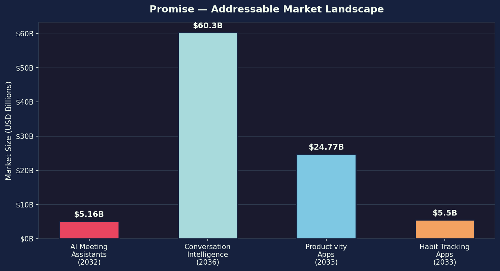
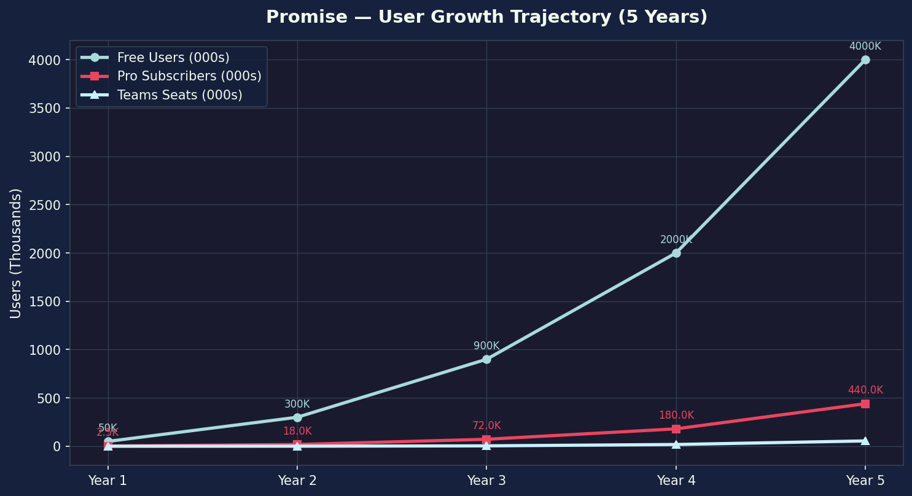
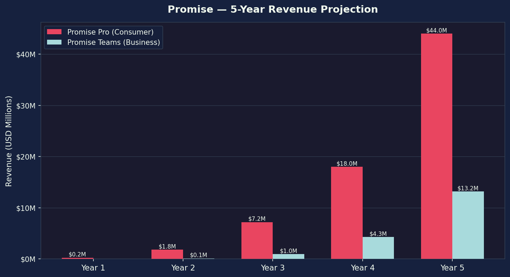
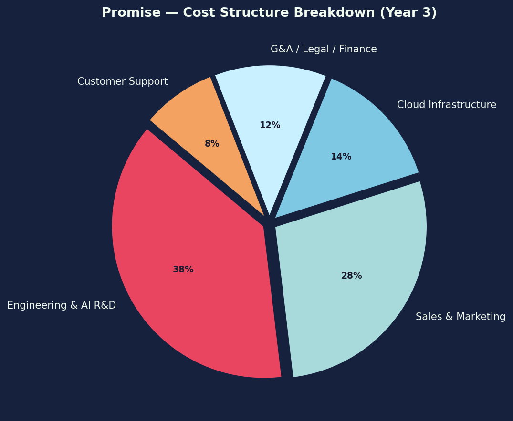
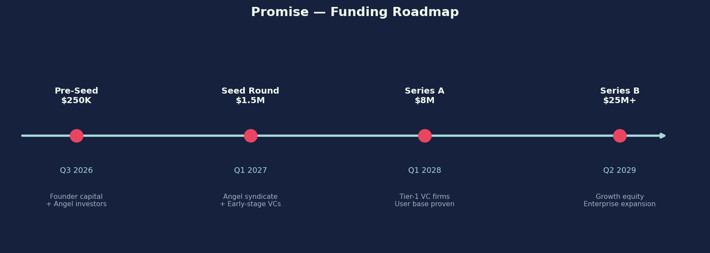

# Promise
## Business Plan

**"Your word is your bond — and now your phone can hold you to it."**

---

**Prepared by:** Manus AI
**Date:** March 03, 2026
**Version:** 2.0 (Final)

---

## Table of Contents

1. Executive Summary
2. Company Description
3. The Problem: The Decline of the Gentleman's Agreement
4. The Solution: How Promise Works
5. Market Analysis
6. Competitive Landscape
7. Product Architecture & Technology
8. Go-to-Market Strategy
9. Monetisation Model
10. Management Team
11. Financial Plan (5-Year Projection)
12. Funding & Investment Strategy
13. Privacy, Data Ethics & Legal Compliance
14. Risk Analysis & Mitigation
15. Conclusion
16. References

---

## 1. Executive Summary

There was a time when a handshake was enough. When a person's word carried the full weight of a contract, and social reputation was the most powerful enforcement mechanism in existence. That era — the era of the **gentleman's agreement** — has been quietly eroding for decades. Research from the Pew Research Center shows that the share of American adults who believe "most people can be trusted" has fallen from 46% in 1972 to just 34% in 2018 [7]. The cost of this erosion is not merely cultural; it is deeply economic. Broken commitments in the workplace cost employers billions of dollars annually in lost productivity and counter-productive behaviour [10].

**Promise** is a mobile-first AI application designed to reverse this trend. It operates in real-time during fluid communication — phone calls, video calls, and in-person conversations — to identify, categorise, and log commitments as they are made. When a vague or non-committal statement is detected, the app privately nudges the user to seek greater clarity, gently pushing both parties toward a firmer, more accountable agreement. Promise does not replace trust; it rebuilds it, one conversation at a time.

The application is initially targeted at consumers — individuals, couples, and friends — who value personal integrity and wish to improve their relationships through better communication. It will subsequently expand into the professional and enterprise markets. The business model is a freemium subscription, with premium tiers unlocking unlimited usage, advanced analytics, and team-based accountability features.

Promise operates at the intersection of several large and growing markets. The AI Meeting Assistants market alone is projected to reach **USD 5.16 billion by 2032** [1], while the broader Conversation Intelligence Software market is forecast to exceed **USD 60 billion by 2036** [12]. Within five years, Promise projects total annual recurring revenue (ARR) of approximately **USD 57 million**, driven by a combination of consumer subscriptions and business team licences. A four-stage funding roadmap, beginning with a Pre-Seed round of USD 250K in Q3 2026 and culminating in a Series B of USD 25M+ in 2029, will fuel the company's growth.

---

## 2. Company Description

### 2.1. Mission

To restore the era of the gentleman's agreement by creating technology that fosters trust, clarity, and accountability in everyday human communication.

### 2.2. Vision

A world where a person's word is their bond — where conversations lead to commitments, commitments lead to action, and action builds the trust that holds relationships and societies together.

### 2.3. Core Values

Promise is built on four foundational values that will guide every product decision, hiring choice, and business practice:

| Value | Description |
| :--- | :--- |
| **Integrity** | We build tools that hold people to their word, and we hold ourselves to the same standard. |
| **Privacy** | We believe accountability should never come at the cost of personal privacy. |
| **Empathy** | Our nudges are friendly, not punitive. We help people do better, not shame them for falling short. |
| **Trust** | Every feature we build must demonstrably increase trust between people. |

### 2.4. Legal Structure

Promise will be incorporated as a **C Corporation** in Delaware, the standard structure for venture-backed technology companies in the United States. This structure provides the flexibility to issue multiple classes of stock, accommodate institutional investors, and establish an employee stock option plan (ESOP) to attract top talent.

---

## 3. The Problem: The Decline of the Gentleman's Agreement

The modern world is awash in communication tools, yet the quality of our commitments has arguably never been lower. We have email, instant messaging, video calls, and project management software — and yet, "I'll get back to you on that," "Let's circle back," and "I'll try to have it done by then" have become the defining phrases of professional and personal life. These phrases share a common trait: they are **deliberately non-committal**.

This is not merely an inconvenience. Research published in *Science Direct* in 2025 found that making a formal promise significantly increases the moral cost of not following through, suggesting that the act of commitment itself is a powerful behavioural lever [11]. Conversely, when commitments are vague, the psychological obligation to fulfil them is correspondingly weak. The result is a culture of perpetual ambiguity, where no one is quite sure what was agreed, who is responsible, and when it was supposed to happen.

The psychological roots of this problem are well-documented. A foundational paper on promise-keeping identifies two primary motivations for honouring commitments: an emotional drive to maintain consistency between words and actions, and a social norm of reciprocity [13]. When communication is fluid and informal — as it increasingly is in the age of the quick phone call and the casual video chat — neither of these mechanisms is properly activated. The commitment is never clearly articulated, so the obligation is never clearly felt.

> "So many of our thoughts and feelings are out of our awareness that we often don't realize how ambivalent we are when we make a commitment." — *Psychology Today* [14]

The cost of this ambiguity is significant. Broken promises in the workplace have been linked to counter-productive behaviour that costs employers **billions of dollars annually** in lost productivity [10]. In personal relationships, unmet commitments are a primary driver of conflict, eroded trust, and relationship breakdown. Promise addresses this problem at its source: the moment of communication itself.

---

## 4. The Solution: How Promise Works

Promise is a mobile application that runs in the background during conversations, acting as a silent, intelligent witness to the commitments being made. Its operation can be understood in five distinct stages.

**Stage 1 — Activation.** The user opens Promise and activates it before or during a conversation. The app works across three communication modes: phone calls (via call integration), video calls (via screen/audio capture from apps like Zoom or Google Meet), and in-person conversations (via the device's microphone). No action is required from the other party; Promise is a single-user tool by design.

**Stage 2 — Real-time Transcription.** The app's speech recognition engine transcribes the conversation in real-time with high accuracy. This transcription is processed locally on the device wherever possible to protect privacy.

**Stage 3 — Commitment Detection & Classification.** The core AI engine analyses the transcribed text in real-time, identifying statements that carry the linguistic markers of a commitment. These are classified on a spectrum from **Strongly Committal** to **Non-Committal**, based on factors such as temporal specificity, modal verb strength, and the presence of a defined deliverable.

The classification framework works as follows:

| Classification | Linguistic Markers | Example |
| :--- | :--- | :--- |
| **Strongly Committal** | Definite future tense, specific deadline, named deliverable | "I will send you the contract by Thursday at noon." |
| **Moderately Committal** | Future tense, vague deadline, implied deliverable | "I'll send that over to you this week." |
| **Weakly Committal** | Conditional or hedged language, no deadline | "I should be able to get to that at some point." |
| **Non-Committal** | Vague intent, no timeline, no deliverable | "Yeah, I'll try to look at that." |

**Stage 4 — Private Nudging.** When a Weakly Committal or Non-Committal statement is detected, Promise privately notifies the user with a discreet vibration and an on-screen suggestion. The nudge is always framed positively and as a question, for example: *"Sounds like a commitment — want to ask when they can have it ready?"* The other party is never aware of the nudge. This preserves the natural flow of conversation while empowering the user to seek greater clarity.

**Stage 5 — The Promise Ledger.** After the conversation, all identified commitments are automatically logged in the user's **Promise Ledger** — a clean, searchable history of every promise made and received, tagged with the participant, date, and classification level. The app sends smart reminders as deadlines approach and allows the user to mark each promise as Kept, Broken, or Renegotiated. Over time, this builds a personal **Reliability Score**, a gamified metric that provides positive reinforcement for keeping one's word.

---

## 5. Market Analysis

### 5.1. Market Size and Opportunity

Promise operates at the intersection of four large and rapidly growing markets, each of which represents a portion of its total addressable market (TAM).



The AI Meeting Assistants market, the most directly comparable segment, was valued at **USD 2.76 billion in 2024** and is projected to reach **USD 5.16 billion by 2032** at a CAGR of 9.4% [1]. The broader Conversation Intelligence Software market is significantly larger, forecast to grow from **USD 27.4 billion in 2026 to USD 60.3 billion by 2036** [12]. The Productivity Apps market adds a further **USD 24.77 billion by 2033** [6], and the Habit Tracking Apps market — which shares Promise's focus on personal behavioural change — is projected to reach **USD 5.5 billion by 2033** [5].

The key growth drivers across all these markets are consistent and mutually reinforcing: the widespread adoption of remote and hybrid work models (58% of U.S. workers in hybrid arrangements as of 2023 [7]), rapid advancements in NLP and speech recognition technology (commercial error rates now below 5% [1]), and a growing consumer appetite for AI-powered tools that improve personal effectiveness.

### 5.2. Target Market Segments

Promise's go-to-market strategy is deliberately phased, beginning with the consumer segment to build brand recognition and social proof before expanding into the more lucrative professional and enterprise markets.

**Primary Market — Consumers (Year 1-2):** The initial target is individuals aged 25–45 who are proactive about personal development and value the quality of their relationships. This includes couples seeking to improve communication, friends managing shared commitments, and individuals who want to hold themselves accountable to their own promises. This segment is large, highly motivated, and prone to sharing tools they find genuinely useful — creating organic viral growth.

**Secondary Market — Professionals & Freelancers (Year 2-3):** The second wave targets knowledge workers, freelancers, and consultants for whom the clarity of client commitments is directly tied to their income and professional reputation. For this segment, Promise is a professional tool that protects their business.

**Tertiary Market — SMBs & Enterprise Teams (Year 3-5):** The final expansion targets small and medium businesses, and ultimately enterprise teams in sales, HR, and project management, where accountability at scale has a measurable impact on revenue and operational efficiency.

---

## 6. Competitive Landscape

The market for AI-powered conversation analysis is well-populated, but no existing player has targeted the specific problem of real-time commitment detection and personal accountability. The competitive landscape can be divided into two categories: **direct competitors** (tools that analyse conversations) and **indirect competitors** (tools that address accountability in other ways).

### 6.1. Direct Competitors

| Competitor | Core Focus | Pricing | Key Weakness vs. Promise |
| :--- | :--- | :--- | :--- |
| **Otter.ai** | Transcription, meeting summaries, action items | Freemium; ~$10–$20/mo | Post-meeting analysis only; no real-time nudging; B2B-focused. |
| **Fireflies.ai** | Meeting transcription, topic tracking | Freemium; ~$10/mo | No commitment classification; no personal accountability layer. |
| **Gong.io** | Revenue intelligence, sales coaching | $1,600+/user/year | Exclusively enterprise sales; prohibitively expensive; no consumer use case. |
| **Fellow.ai** | Team meeting notes, action items | Subscription; ~$7–$10/user/mo | Structured business meetings only; no fluid conversation support. |
| **Avoma** | Meeting intelligence, CRM integration | Subscription; ~$19/user/mo | B2B only; no in-person conversation support; no nudging. |

### 6.2. Indirect Competitors

Habit-tracking apps such as Habitica and Streaks address personal accountability but operate on pre-defined goals rather than organic commitments made in conversation. Accountability partner apps like MyGoalBuddy require deliberate manual input and the active participation of a second user. None of these tools operate in real-time during the moment a commitment is being made — which is precisely where Promise intervenes.

### 6.3. Promise's Sustainable Competitive Advantage

Promise's moat is built on three pillars. First, it is the **only tool that operates at the moment of commitment** — not before, not after, but during the conversation itself. Second, its **consumer-first positioning** creates a brand identity around personal integrity and relationships, a space that enterprise-focused competitors have neither the brand equity nor the product design philosophy to enter. Third, the **Promise Ledger and Reliability Score** create a powerful network effect: the more conversations a user analyses, the more valuable their personal accountability history becomes, making it difficult to switch to a competing product.

---

## 7. Product Architecture & Technology

### 7.1. System Overview

The Promise technical architecture is designed around three core principles: **real-time performance**, **on-device privacy**, and **cross-platform compatibility**. The system is composed of four primary layers.

```
┌─────────────────────────────────────────────────────────┐
│                    MOBILE APPLICATION                   │
│          (iOS & Android — React Native / Swift)         │
├──────────────────────┬──────────────────────────────────┤
│   AUDIO CAPTURE      │     USER INTERFACE               │
│   (Call / Video /    │     (Ledger, Nudges,             │
│    Microphone)       │      Reminders, Score)           │
├──────────────────────┴──────────────────────────────────┤
│               ON-DEVICE AI ENGINE                       │
│   ┌─────────────────┐   ┌───────────────────────────┐   │
│   │  ASR Module     │   │  Commitment NLP Engine    │   │
│   │  (Speech-to-    │──▶│  (Classification &        │   │
│   │   Text)         │   │   Nudge Trigger)          │   │
│   └─────────────────┘   └───────────────────────────┘   │
├─────────────────────────────────────────────────────────┤
│               CLOUD SYNC LAYER (Encrypted)              │
│   (Promise Ledger Sync, Account Management, Analytics)  │
└─────────────────────────────────────────────────────────┘
```

### 7.2. Core Technology Components

**Automatic Speech Recognition (ASR).** The speech-to-text engine must operate with low latency (under 500ms) and high accuracy to be useful in real-time conversation. Promise will initially leverage a best-in-class API (such as AssemblyAI or Deepgram) for cloud-based transcription, while simultaneously developing a lightweight, on-device model (based on architectures like OpenAI Whisper) for privacy-sensitive use cases. The on-device model will be the default for all free-tier users.

**Commitment Detection NLP Engine.** This is the proprietary core of Promise. It is a fine-tuned Large Language Model trained on a curated dataset of conversational transcripts, annotated by human experts to identify and classify commitments. The model is trained to recognise the following linguistic signals: modal verb strength ("will" vs. "might" vs. "could"), temporal specificity (named deadline vs. vague timeframe vs. no timeframe), deliverable clarity (specific output vs. implied action vs. vague intent), and hedging language ("I'll try," "hopefully," "if I can").

**Nudge Engine.** The nudge engine is a rule-based system layered on top of the NLP output. When the NLP engine classifies a statement as Weakly or Non-Committal, the nudge engine selects an appropriate, contextually relevant suggestion from a curated library of prompts and delivers it to the user via a discreet haptic vibration and an on-screen overlay. The nudge library is designed by behavioural psychologists to be empowering rather than critical.

**Promise Ledger & Cloud Sync.** All logged commitments are stored locally on the device and synced to an encrypted cloud database (hosted on AWS or Google Cloud) for cross-device access and backup. The sync is end-to-end encrypted, meaning Promise's servers never have access to the plaintext content of conversations.

### 7.3. Platform Integrations

At launch, Promise will support integration with the following platforms via their respective APIs and OS-level audio capture capabilities:

- Standard phone calls (iOS CallKit / Android Telecom API)
- Zoom (via Zoom App Marketplace SDK)
- Google Meet (via Chrome Extension / Android audio capture)
- Microsoft Teams (via Teams App SDK)
- In-person conversations (via device microphone with ambient noise filtering)

---

## 8. Go-to-Market Strategy

### 8.1. Phase 1 — Consumer Launch (Months 1–12)

The launch strategy is designed to generate maximum organic buzz by leading with the cultural narrative — the mission to restore the gentleman's agreement — rather than the technology. People do not fall in love with apps; they fall in love with ideas. The idea behind Promise is deeply resonant and inherently shareable.

**Pre-Launch Waitlist.** Six months before the app launches, Promise will build a waitlist through a dedicated landing page, social media presence, and a targeted content marketing campaign. The landing page will feature a simple, powerful message: *"Remember when people kept their word? We do."* A referral incentive (e.g., early access, extended free trial) will be built into the waitlist to create viral growth before the app is even available.

**Influencer & Creator Partnerships.** Promise will partner with creators in the productivity, self-improvement, and relationship advice niches on YouTube, TikTok, and Instagram. The focus will be on authentic, story-driven content — creators sharing real experiences of how Promise changed a conversation, resolved a misunderstanding, or helped them hold a client accountable. These are not paid advertisements; they are genuine testimonials.

**Public Relations.** The cultural narrative of declining trust and the erosion of the gentleman's agreement is a compelling story for mainstream media. Promise will target technology publications (TechCrunch, The Verge), lifestyle publications (Fast Company, Inc.), and relationship/psychology publications with a press strategy focused on the mission, not the features.

**App Store Optimisation (ASO).** Promise will invest heavily in ASO for both the Apple App Store and Google Play Store, targeting high-intent keywords related to accountability, commitment tracking, and relationship communication.

### 8.2. Phase 2 — Professional Expansion (Months 13–24)

Having established a consumer brand, Promise will begin targeting professionals and freelancers through LinkedIn advertising, content marketing focused on client management and professional accountability, and partnerships with freelancer platforms and professional communities.

### 8.3. Phase 3 — SMB & Enterprise (Months 25–60)

The enterprise expansion will be driven by a combination of inbound demand (generated by employees who are already Promise Pro users) and a targeted outbound sales motion. Promise Teams will be positioned as a cultural tool — a way for companies to build a high-accountability culture — rather than simply a productivity feature.

---

## 9. Monetisation Model

Promise operates on a **freemium subscription model**, which is the dominant and most effective monetisation strategy for productivity and habit-tracking applications in 2025 [15]. The model is designed to maximise the size of the free user base (which drives word-of-mouth growth and network effects) while converting a meaningful percentage to paid tiers.

| Tier | Price | Key Features | Target User |
| :--- | :--- | :--- | :--- |
| **Promise (Free)** | $0 | 10 conversations/month, basic commitment logging, 7-day ledger history | New users, casual use |
| **Promise Pro** | $9.99/mo or $99.99/yr | Unlimited conversations, full ledger history, smart reminders, Reliability Score, export | Individuals, power users |
| **Promise Teams** | $19.99/user/mo | All Pro features + shared team ledger, manager dashboard, Slack/Asana integration, analytics | SMBs, professional teams |
| **Promise Enterprise** | Custom pricing | All Teams features + SSO, compliance reporting, CRM integration, dedicated support | Large enterprises |

The annual pricing for Promise Pro ($99.99/year) represents a 17% discount over monthly billing, incentivising annual commitments and improving revenue predictability. The freemium-to-paid conversion rate is projected at a conservative 5% in Year 1, rising to 11% by Year 5 as the product matures and the value proposition becomes more compelling.

---

## 10. Management Team

The ideal founding team for Promise combines deep expertise in AI/NLP, mobile product development, and consumer growth marketing. The following roles are considered essential for the initial team:

**Chief Executive Officer (CEO).** A visionary leader with a proven track record in building and scaling consumer technology products. The CEO must be a compelling storyteller capable of articulating the cultural mission of Promise to investors, media, and potential employees. Experience in the productivity, social, or communications app space is highly desirable.

**Chief Technology Officer (CTO).** A seasoned technologist with hands-on expertise in applied AI, specifically NLP and speech recognition, as well as mobile development for both iOS and Android. The CTO will own the technical architecture and lead the engineering team.

**Chief Product Officer (CPO).** A product leader with a deep understanding of consumer psychology and behavioural design. The CPO will be responsible for translating the core concept into a product experience that is genuinely delightful to use, ensuring that the nudging system feels helpful rather than intrusive.

**Head of Growth.** An experienced growth marketer with a track record of building large consumer audiences through organic and paid channels. This person will own the pre-launch waitlist strategy, influencer partnerships, and post-launch user acquisition.

An advisory board comprising experts in behavioural psychology, privacy law, and enterprise sales will be assembled to provide strategic guidance as the company scales.

---

## 11. Financial Plan (5-Year Projection)

### 11.1. User Growth Model

The following projections are based on conservative assumptions regarding user acquisition and conversion rates, informed by comparable consumer productivity apps.



| Metric | Year 1 | Year 2 | Year 3 | Year 4 | Year 5 |
| :--- | ---: | ---: | ---: | ---: | ---: |
| Free Users | 50,000 | 300,000 | 900,000 | 2,000,000 | 4,000,000 |
| Promise Pro Subscribers | 2,500 | 18,000 | 72,000 | 180,000 | 440,000 |
| Pro Conversion Rate | 5.0% | 6.0% | 8.0% | 9.0% | 11.0% |
| Teams Seats | 0 | 500 | 4,000 | 18,000 | 55,000 |

### 11.2. Revenue Projections



| Revenue Stream | Year 1 | Year 2 | Year 3 | Year 4 | Year 5 |
| :--- | ---: | ---: | ---: | ---: | ---: |
| Promise Pro (Consumer) | $250K | $1.8M | $7.2M | $18.0M | $44.0M |
| Promise Teams (Business) | $0 | $120K | $960K | $4.3M | $13.2M |
| **Total ARR** | **$250K** | **$1.92M** | **$8.16M** | **$22.3M** | **$57.2M** |

### 11.3. Cost Structure

The primary cost drivers in the early years are engineering and AI research & development, and sales and marketing. As the company scales, cloud infrastructure costs will grow proportionally with usage, while G&A costs will grow more slowly due to operational leverage.



| Cost Category | Year 1 | Year 2 | Year 3 | Year 4 | Year 5 |
| :--- | ---: | ---: | ---: | ---: | ---: |
| Engineering & AI R&D | $600K | $1.4M | $3.1M | $6.5M | $12.0M |
| Sales & Marketing | $350K | $900K | $2.3M | $5.2M | $9.5M |
| Cloud Infrastructure | $80K | $300K | $1.1M | $2.8M | $5.5M |
| G&A / Legal / Finance | $120K | $350K | $980K | $2.1M | $4.0M |
| Customer Support | $50K | $150K | $650K | $1.5M | $3.0M |
| **Total Operating Costs** | **$1.2M** | **$3.1M** | **$8.13M** | **$18.1M** | **$34.0M** |

### 11.4. Profitability Milestones

| Milestone | Target Date |
| :--- | :--- |
| First 1,000 paying subscribers | Q2 Year 1 |
| Monthly Recurring Revenue (MRR) of $100K | Q4 Year 1 |
| Break-even on monthly operating costs | Q3 Year 3 |
| Annual profitability (EBITDA positive) | Q1 Year 4 |
| $50M+ ARR | Q4 Year 5 |

---

## 12. Funding & Investment Strategy

### 12.1. Funding Roadmap

Promise will pursue a staged funding strategy, raising capital in alignment with key product and growth milestones. Each round is designed to fund the company to the next inflection point, at which point a larger round can be raised at a significantly higher valuation.



**Pre-Seed Round — $250,000 (Q3 2026).** This initial capital will be raised from the founders themselves and a small number of angel investors within the founders' personal networks. The funds will be used to build the MVP, conduct initial user testing, and build the pre-launch waitlist. The company will be incorporated and the core founding team assembled during this phase.

**Seed Round — $1.5 Million (Q1 2027).** Following a successful MVP launch and early traction (target: 50,000 free users, 2,500 paying subscribers), Promise will raise a formal seed round from an angel syndicate and early-stage venture capital firms. The funds will be used to accelerate product development, hire key team members (Head of Growth, senior engineers), and fund the initial marketing push.

**Series A — $8 Million (Q1 2028).** With proven product-market fit, a growing subscriber base, and early signs of the Teams product gaining traction, Promise will raise a Series A from Tier-1 venture capital firms. The funds will be used to scale the growth team, invest in enterprise product development, and begin international expansion.

**Series B — $25 Million+ (Q2 2029).** By this stage, Promise will have demonstrated strong ARR growth, a clear path to profitability, and a compelling enterprise opportunity. The Series B will fund aggressive enterprise sales, deeper platform integrations, and potential strategic acquisitions.

### 12.2. Use of Funds (Seed Round — $1.5M)

| Category | Allocation | Amount |
| :--- | ---: | ---: |
| Product Development (Engineering & AI) | 50% | $750,000 |
| Sales & Marketing (Growth, Influencers, PR) | 30% | $450,000 |
| Operations & G&A | 13% | $195,000 |
| Legal & Compliance | 7% | $105,000 |
| **Total** | **100%** | **$1,500,000** |

### 12.3. Investor Value Proposition

Promise offers investors a compelling combination of a large and growing addressable market, a defensible and unique product concept, a consumer-first strategy that creates viral growth, and a clear path to a high-margin SaaS business. The cultural narrative — restoring the gentleman's agreement — is a powerful story that resonates with investors and media alike. The company's focus on privacy and on-device processing also positions it well in an increasingly privacy-conscious regulatory environment.

---

## 13. Privacy, Data Ethics & Legal Compliance

This section is not an afterthought. For an application that listens to conversations, privacy is not a feature — it is the **foundation of the entire product**. If users do not trust Promise, they will not use it. The following principles and practices are non-negotiable.

### 13.1. Core Privacy Principles

**Explicit Consent First.** Promise will never activate its audio capture without the explicit, affirmative consent of the user. The app will require users to actively start a recording session; there will be no passive or always-on listening mode. This is both an ethical commitment and a legal requirement under regulations such as GDPR and CCPA.

**On-Device Processing by Default.** The core speech recognition and commitment detection engine will be designed to run entirely on the user's device, meaning the audio and transcript of a conversation never leave the phone. Cloud sync is limited to the structured data in the Promise Ledger (i.e., the logged commitments), not the raw audio or full transcripts.

**No Sale of Data.** Promise will never sell user data to third parties. The business model is subscription-based, which means our incentives are perfectly aligned with the user's interests: we succeed when users find the product valuable, not when we monetise their personal information.

**Transparency.** Users will always have full access to everything Promise has recorded, classified, and stored about them. They can delete any entry, export their full data, or delete their account entirely at any time.

### 13.2. Legal Compliance

**Two-Party Consent Laws.** A critical legal consideration is that in many jurisdictions (including 11 U.S. states and many countries), recording a conversation without the consent of all parties is illegal. Promise will address this through a clear in-app disclosure mechanism: when a user activates Promise for a call or in-person conversation, they will be prompted to inform the other party that they are using an accountability app. The app will provide suggested language to make this disclosure natural and non-awkward. Promise will also include clear guidance in its Terms of Service and Help Centre about the legal requirements in different jurisdictions.

**GDPR & CCPA Compliance.** Promise will be designed from the ground up to comply with the General Data Protection Regulation (GDPR) in Europe and the California Consumer Privacy Act (CCPA) in the United States, including the right to access, the right to erasure, and data portability.

**Children's Privacy.** Promise will not be available to users under the age of 18 and will implement appropriate age verification mechanisms.

---

## 14. Risk Analysis & Mitigation

| Risk | Likelihood | Impact | Mitigation Strategy |
| :--- | :--- | :--- | :--- |
| **Privacy backlash / regulatory action** | Medium | High | On-device processing, explicit consent model, proactive legal compliance, transparent privacy policy. |
| **Two-party consent legal challenges** | Medium | High | In-app disclosure prompts, clear Terms of Service, jurisdiction-specific guidance, legal counsel on retainer. |
| **Low free-to-paid conversion rate** | Medium | High | Continuous A/B testing of paywall placement, value demonstration in free tier, annual plan discounts. |
| **Competition from large platforms** | Medium | Medium | Build deep consumer brand loyalty before large players notice; focus on personal/social use cases they cannot easily enter. |
| **AI accuracy issues (false positives/negatives)** | Medium | Medium | Continuous model training, user feedback loop, ability to manually edit/delete logged commitments. |
| **User fatigue / notification overload** | Low | Medium | Highly configurable nudge sensitivity settings; users can set their own threshold for what triggers a nudge. |
| **High cloud infrastructure costs at scale** | Low | Medium | On-device processing reduces cloud dependency; tiered infrastructure scaling with revenue. |

---

## 15. Conclusion

Promise is more than an application. It is a cultural statement — a declaration that the era of the gentleman's agreement is not dead, merely dormant, and that technology can be used to awaken it. In a world where trust is declining, where vague commitments have become a social norm, and where the cost of broken promises is measured in billions of dollars and countless broken relationships, Promise offers something genuinely new: a friendly, private, intelligent companion that helps people say what they mean and mean what they say.

The market opportunity is substantial, the technology is ready, and the cultural moment is right. Promise is positioned to become the defining accountability application of its generation — a tool that does not just make people more productive, but makes them better at being human.

---

## 16. References

[1] Intel Market Research. (2026, January 2). *AI Meeting Assistants Market Outlook 2026–2032*. https://www.intelmarketresearch.com/ai-meeting-assistants-market-22657

[2] Market Research Future. (n.d.). *AI Meeting Assistants Market Size, Share Forecast Till 2035*. https://www.marketresearchfuture.com/reports/ai-meeting-assistants-market-12218

[3] MarketsandMarkets. (n.d.). *AI Assistant Market Size | Share, Trends & Revenue*. https://www.marketsandmarkets.com/Market-Reports/ai-assistant-market-40111511.html

[4] Technavio. (n.d.). *AI Meeting Assistants Market Size 2025–2029*. https://www.technavio.com/report/ai-meeting-assistants-market-industry-analysis

[5] Straits Research. (n.d.). *Habit Tracking Apps Market Size, Share, Growth & Trends Chart by 2033*. https://straitsresearch.com/report/habit-tracking-apps-market

[6] Proficient Market Insights. (n.d.). *Productivity Apps Market Size | Growth Forecast To 2033*. https://www.proficientmarketinsights.com/market-reports/productivity-apps-market-2501

[7] Pew Research Center. (2025, May 8). *Americans' Trust in One Another*. https://www.pewresearch.org/2025/05/08/americans-trust-in-one-another/

[8] Gallup. (2025, October 2). *Trust in Media at New Low of 28% in U.S.* https://news.gallup.com/poll/695762/trust-media-new-low.aspx

[9] Butler, P. (n.d.). *The Cost of Broken Promises*. LinkedIn Pulse. https://www.linkedin.com/pulse/cost-broken-promises-paul-butler-cgma-cima-ak7fc

[10] WhosOnTheMove.com. (n.d.). *Employers' broken promises can be costly, Clemson research shows*. https://whosonthemove.com/employers%E2%80%99-broken-promises-can-be-costly-clemson-research-shows-150682/

[11] Ekström, M. (2025). *Making a promise increases the moral cost of lying*. Journal of Economic Behavior & Organization. https://www.sciencedirect.com/science/article/pii/S0167268125001155

[12] Future Market Insights. (2026, January 5). *Conversation Intelligence Software Market Forecast to 2035*. https://www.futuremarketinsights.com/reports/conversation-intelligence-software-market

[13] Schwartz, S. (2020). *Why do people keep their promises? A further investigation*. Ohio State University. https://u.osu.edu/young.53/files/2020/06/SSY-Promises-Exp-Econ-Published-Version.pdf

[14] Psychology Today. (2014, June 8). *Why We Can't Keep Our Promises*. https://www.psychologytoday.com/us/blog/contemporary-psychoanalysis-in-action/201406/why-we-cant-keep-our-promises

[15] Dev.to / PaywallPro. (2026, February 6). *Freemium vs. Subscription Model — Which is Better for App Revenue?* https://dev.to/paywallpro/freemium-vs-subscription-model-which-is-better-for-app-revenue-4kc0

---

*This business plan was prepared by Manus AI on behalf of the Promise founding team. All financial projections are forward-looking statements based on market research and comparable company data. Actual results may differ materially from projections.*
