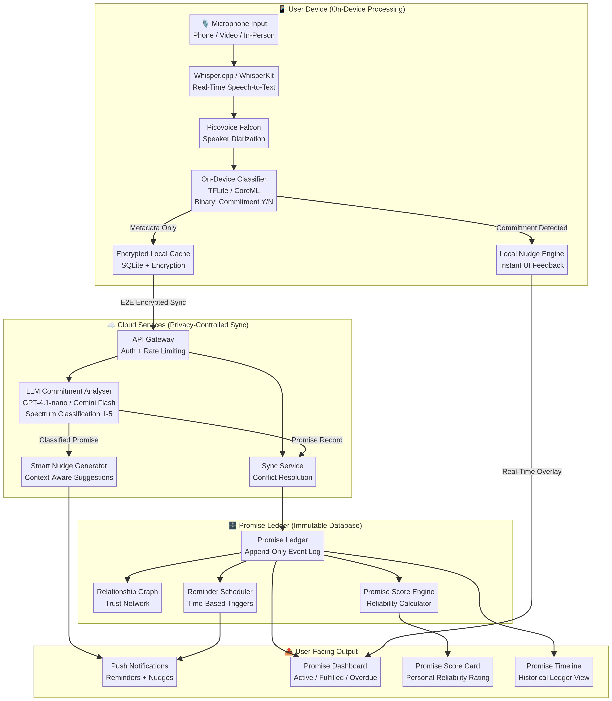
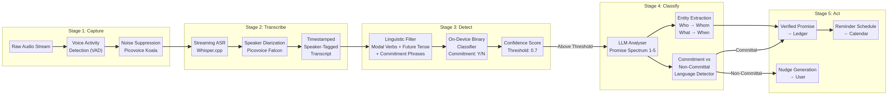
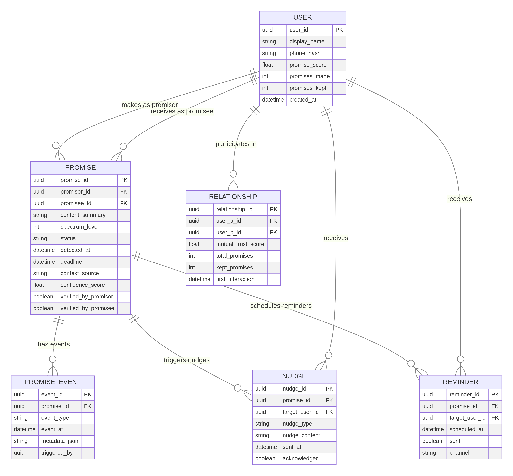

# Promise: Technische Architectuur & Systeemontwerp

**Datum:** 5 maart 2026
**Auteur:** Manus AI

## 1. Introductie en Ontwerpprincipes

Dit document beschrijft de technische architectuur voor **Promise**, een applicatie ontworpen om de cultuur van de "gentleman's agreement" te digitaliseren en te herstellen. Het doel van het systeem is om mensen te helpen hun beloftes sneller, completer en beter na te komen door middel van real-time spraakanalyse, gedragsnudges en een onveranderlijk belofte-ledger.

De architectuur is gebouwd op vier fundamentele ontwerpprincipes:
1. **Privacy-First (On-Device Processing)**: Omdat de app meeluistert met gesprekken, moet de ruwe audio het apparaat nooit verlaten. Alle spraakherkenning en initiële detectie gebeurt lokaal.
2. **Ultra-Low Latency**: Om effectieve 'nudges' te kunnen geven tijdens een gesprek, moet de detectie-loop (spraak → tekst → NLP → UI) binnen milliseconden plaatsvinden.
3. **Immutable Ledger**: Een belofte is een contract. De database-architectuur moet fungeren als een onveranderlijk logboek (append-only) om vertrouwen te garanderen.
4. **Behavioral Design**: De technologie is ondergeschikt aan de psychologie. Het systeem is ontworpen om zachte, context-bewuste nudges te leveren die gedragsverandering stimuleren zonder irritatie op te wekken.

---

## 2. High-Level Systeemarchitectuur

Het systeem is opgedeeld in vier hoofddomeinen: het gebruikersapparaat (Edge), de cloud-diensten, de data-laag (Ledger), en de user-facing output.

### 2.1 User Device (On-Device Processing)
De mobiele applicatie (iOS/Android) fungeert als de primaire sensor en eerste verwerkingslaag.
- **Microphone Input**: Vangt audio op tijdens telefoongesprekken, videocalls of in-persoon gesprekken (met expliciete toestemming).
- **Real-Time Speech-to-Text**: Maakt gebruik van **Whisper.cpp** of **WhisperKit** (op iOS via de Apple Neural Engine) voor snelle, lokale transcriptie zonder cloud-afhankelijkheid [1].
- **Speaker Diarization**: Implementeert **Picovoice Falcon** om in real-time te bepalen *wie* er spreekt ("Speaker 1" vs "Speaker 2"), wat cruciaal is om de promisor (belover) en promisee (ontvanger) te identificeren [2].
- **On-Device Classifier**: Een lichtgewicht TensorFlow Lite of CoreML model dat een binaire classificatie uitvoert: bevat deze zin een potentiële belofte (Ja/Nee)?

### 2.2 Cloud Services (Privacy-Controlled Sync)
Alleen de geëxtraheerde metadata (de tekst van de belofte, niet de volledige audio) wordt via end-to-end encryptie naar de cloud gestuurd voor diepere analyse.
- **LLM Commitment Analyser**: Een geoptimaliseerd Large Language Model (zoals GPT-4.1-nano of Gemini Flash) analyseert de context, extraheert entiteiten (wie, wat, wanneer) en classificeert de belofte op het **Promise Spectrum (Niveau 1-5)**.
- **Smart Nudge Generator**: Bepaalt op basis van de LLM-analyse of de taal te vaag ("non-committal") was en genereert een suggestie om dit concreter te maken.

### 2.3 Promise Ledger (Immutable Database)
De data-laag is ontworpen als een financieel grootboek, maar dan voor sociaal kapitaal.
- **Append-Only Event Log**: Elke actie (creatie, verificatie, herinnering, nakoming, breuk) wordt als een onveranderlijk event opgeslagen.
- **Promise Score Engine**: Berekent dynamisch de betrouwbaarheidsscore van een gebruiker op basis van historische data.

---

## 3. De NLP Pipeline: Van Spraak naar Belofte

De kern van Promise is de Natural Language Processing (NLP) pipeline die in staat is om 'Commissive Speech Acts' (taalhandelingen die de spreker binden aan een toekomstige actie) te detecteren [3].

### Stage 1 & 2: Capture & Transcribe
De ruwe audio passeert eerst een Voice Activity Detection (VAD) filter en ruisonderdrukking (bijv. Picovoice Koala) om batterij te besparen en accuraatheid te verhogen. Daarna wordt de audio gestreamd door de lokale Whisper-engine en getagd met spreker-ID's.

### Stage 3: Detect (On-Device)
Om latency te minimaliseren, gebruikt de app een lokale linguïstische filter. Deze zoekt naar modale werkwoorden ("zullen", "moeten"), toekomstige tijd, en specifieke belofte-frasen. Een lichtgewicht neuraal netwerk berekent een betrouwbaarheidsscore. Als deze boven de drempelwaarde (bijv. 0.7) komt, wordt de zin gemarkeerd als een potentiële belofte.

### Stage 4: Classify (Cloud LLM)
De potentiële belofte wordt asynchroon naar de cloud gestuurd. Het LLM voert drie taken uit:
1. **Entity Extraction**: Wie doet de belofte? Aan wie? Wat is de actie? Wat is de deadline?
2. **Spectrum Classificatie**: Is dit een Micro-belofte (Niveau 1: "Ik bel je terug") of een Macro-belofte (Niveau 5: "Ik investeer in je bedrijf")?
3. **Taalanalyse**: Is de taal 'committal' ("Ik doe het") of 'non-committal' ("Ik zal proberen er naar te kijken")?

### Stage 5: Act
Op basis van de classificatie wordt de belofte vastgelegd in het ledger, of wordt er een real-time 'nudge' teruggestuurd naar het apparaat van de gebruiker om de vage taal te corrigeren.

---

## 4. Database Schema: Het Promise Ledger

Het datamodel van Promise is gebaseerd op de principes van een financieel grootboek (ledger) en de theorie van 'Commitment Escalation' [4]. Het is ontworpen om onveranderlijkheid en traceerbaarheid te garanderen.

### 4.1 Kernentiteiten
- **USER**: Bevat de profielgegevens en de berekende `promise_score` (betrouwbaarheid).
- **PROMISE**: De centrale entiteit. Bevat de inhoud, de deadline, het `spectrum_level` (1-5), en de verificatiestatus van beide partijen.
- **PROMISE_EVENT**: Het append-only logboek. Elke wijziging aan een belofte (creatie, verificatie, herinnering, nakoming) is een nieuw event. Dit voorkomt dat historische data wordt overschreven.
- **RELATIONSHIP**: Een unieke entiteit die de `mutual_trust_score` tussen twee specifieke gebruikers bijhoudt. Dit maakt het mogelijk om te zien hoe betrouwbaar iemand is ten opzichte van een specifieke persoon, niet alleen in het algemeen.
- **NUDGE & REMINDER**: Tabellen voor het plannen en loggen van gedragsinterventies.

---

## 5. User Flow & Behavioral Design

De technologie is slechts een middel; het doel is gedragsverandering. De user flow is ontworpen om de principes van 'Nudge Theory' toe te passen [5].

### 5.1 De Nudge Loop
Wanneer de app meeluistert (met toestemming) en een potentiële belofte detecteert, classificeert de NLP-engine deze als 'Committal' of 'Non-Committal'.
- **Committal**: "Ik stuur je dat rapport morgen." → De app verifieert dit bij beide partijen en slaat het op in het ledger.
- **Non-Committal**: "Ik zal proberen er morgen naar te kijken." → De app stuurt een zachte, real-time nudge naar de spreker: *"Wil je hier een concrete belofte van maken met een deadline?"*

### 5.2 De Escalatie Ladder
Beloftes worden geclassificeerd op het Promise Spectrum (Niveau 1-5). Dit bepaalt de intensiteit van de app-interventies:
- **Micro (Niveau 1)**: "Ik bel je zo terug." → Krijgt alleen een stille notificatie.
- **Macro (Niveau 5)**: "Ik investeer in je bedrijf." → Vereist dubbele verificatie, formele vastlegging, en heeft een enorme impact op de Promise Score.

### 5.3 De Feedback Loop (Promise Score)
Wanneer een deadline wordt bereikt, vraagt de app om bevestiging van nakoming.
- **Nagekomen**: De Promise Score van de promisor stijgt. Het onderlinge vertrouwen (Relationship Score) groeit.
- **Verlopen**: De app stuurt een zachte herinnering. Als de belofte alsnog niet wordt nagekomen, daalt de Promise Score. Dit creëert de sociale druk die vroeger inherent was aan de gentleman's agreement.

---

## 6. Conclusie en Volgende Stappen

De architectuur van Promise combineert state-of-the-art on-device AI (Whisper, Picovoice) met een robuust, onveranderlijk datamodel (Ledger) en diepgaande gedragspsychologie (Nudge Theory). Het resultaat is een systeem dat niet alleen registreert wat we zeggen, maar ons actief helpt om betere, betrouwbaardere versies van onszelf te worden.

**Aanbevolen Volgende Stappen voor Ontwikkeling:**
1. **Proof of Concept (PoC) NLP Pipeline**: Bouw een lokaal prototype met Whisper.cpp en een klein LLM om de latency van de detectie-loop te testen.
2. **UI/UX Prototyping van de Nudge**: Ontwerp de interface voor de real-time nudges. Deze moeten subtiel genoeg zijn om een gesprek niet te verstoren, maar duidelijk genoeg om gedrag te sturen.
3. **Ledger Database Setup**: Implementeer het append-only event log in PostgreSQL of een gespecialiseerde ledger database (zoals Amazon QLDB) om de onveranderlijkheid te garanderen.

---

## Referenties

[1] OpenAI. (2022). *Introducing Whisper*. https://openai.com/index/whisper/

[2] Picovoice. (2024). *Falcon Speaker Diarization*. https://picovoice.ai/platform/falcon/

[3] Qadir, A., & Riloff, E. (2011). Classifying Sentences as Speech Acts in Message Board Posts. *Proceedings of the 2011 Conference on Empirical Methods in Natural Language Processing*, 748–758.

[4] Staw, B. M. (1981). The escalation of commitment to a course of action. *Academy of Management Review*, 6(4), 577-587.

[5] Thaler, R. H., & Sunstein, C. R. (2008). *Nudge: Improving decisions about health, wealth, and happiness*. Yale University Press.
